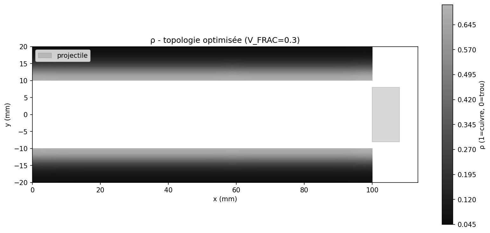
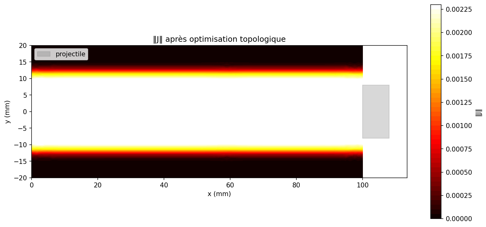

# Railgun rail topology optimisation

Where should the copper go in a railgun rail? A SIMP topology optimiser with an adjoint gradient,
written in NGSolve, rediscovers that it belongs **along the inner edge, facing the other rail**.
With 40 % less copper, that layout keeps **67 %** of the full rail's objective, against **39 %**
when the same copper is removed from the wrong side.

**My contribution:** Team project. My part: the weak formulation and its well-posedness proof,
the NGSolve SIMP/adjoint optimiser, and the analysis of its results.



## Approach

- **State equation.** Stationary electrokinetics in one rail (the other by symmetry):
  −∇·(σ(ρ)∇V) = 0, V = 1 on the current inlet, V = 0 on the outlet, insulated elsewhere. Weak form
  ∫ σ(ρ) ∇V·∇v dΩ = 0; the bilinear form is coercive because σ ≥ σ_min > 0, so Lax-Milgram gives
  existence and uniqueness for every density.
- **Design variable.** SIMP density ρ ∈ [0, 1] with σ(ρ) = σ_min + (σ_Cu − σ_min) ρ^p,
  σ_min = 10⁻⁴ σ_Cu, and a continuation p = 1 → 4 over 80 iterations.
- **Objective.** Maximise ∫ w(y) σ |∇V|² dΩ with w ∝ 1/d², d being the distance to the opposite
  rail: a local stand-in for Biot-Savart, since current close to the other rail contributes more
  to the field at the projectile.
- **Gradient by the adjoint method**, then Helmholtz filtering (r = 2.5 mm) against
  checkerboarding, a normalised projected-gradient step, and a volume constraint enforced
  exactly by bisection.
- **Discretisation.** P1 Lagrange elements on a Netgen triangulation, 100 × 10 mm rail,
  h = 1.5 mm (954 elements).

## Results

The optimiser is judged against designs that use **the same volume of copper**, all evaluated
with the same objective and the same penalisation (`compare_baselines.py`):

| Copper volume | Optimised, binarised | Hand-drawn inner strip | Outer strip | Optimised ÷ inner | Inner ÷ outer |
|---|---|---|---|---|---|
| 30 % | 9.13e-5 | 8.32e-5 | 3.81e-5 | 1.10 | 2.18 |
| 40 % | 1.25e-4 | 1.19e-4 | 6.09e-5 | 1.04 | 1.96 |
| 50 % | 1.55e-4 | 1.55e-4 | 8.87e-5 | 1.00 | 1.75 |
| 60 % | 1.78e-4 | 1.71e-4 | 1.05e-4 | 1.04 | 1.63 |
| 70 % | 2.01e-4 | 1.95e-4 | 1.33e-4 | 1.03 | 1.47 |
| 80 % | 2.23e-4 | 2.22e-4 | 1.71e-4 | 1.01 | 1.30 |

Full copper rail: 2.67e-4. Two findings:

- **Placement matters, and the optimiser finds it.** Putting the copper on the inner edge is
  worth 1.3× to 2.2× over the outer edge, more so the less copper there is. Binarised, the
  optimiser's design matches or slightly beats (0–10 %) the inner strip one would draw by hand —
  it converges to the physically expected answer, not to something new.
- **The raw output is not a usable design.** Before binarisation the density stays grey (at 30 %
  volume, ρ peaks at 0.70 and 14 % of nodes are intermediate) and scores 1.5× (80 % volume) to
  5.3× (30 %) lower than its own binarised version.



## Limitations

- **The headline gain of the main script is not a real gain.** `railgun_topopt.py` reports
  ×7.87 at 30 % volume, measured against a uniform ρ = 0.3 rail whose penalised conductivity is
  0.3⁴ ≈ 0.008 — a material that does not exist. Against a solid strip of the same volume, the
  gain is 1.10×. The table above is the honest comparison.
- **The optimiser does not converge to a 0/1 design.** The continuation ends at p = 4 with grey
  regions left; a projection filter (Heaviside) or more iterations at high p would be needed.
- **No real topology appears.** Nothing in the model varies along the rail, so the optimum is a
  strip, not a shape with holes. Optimising both rails and the projectile together, or adding a
  mechanical constraint, would be needed for a non-trivial layout.
- **The objective is a proxy for the Lorentz force**, not the force itself: the 1/d² weight
  replaces a Biot-Savart integral, and absolute values have no physical unit.
- **Stationary physics.** A ~1 ms pulse induces −∂A/∂t, and the skin depth (≈ 5 mm at the
  equivalent frequency) is comparable to the rail width; neither is modelled. An A-V harmonic
  formulation is the next step.
- **Not validated against an independent solver.** COMSOL was not used, and no mesh-convergence
  study was done (single mesh, h = 1.5 mm).
- **The volume sweep inside the main script uses 40 iterations**, the final run 80, so its
  printed gains are not comparable across rows. `compare_baselines.py` runs 80 iterations for
  every volume.

## Reproduce

```bash
python -m venv venv && source venv/bin/activate
pip install -r requirements.txt

python railgun_topopt.py      # volume sweep + final optimisation at 30 %, figures (~5 min)
python compare_baselines.py   # results table above (~10 min)
```

Tested with Python 3.9 and NGSolve 6.2.2506. Figures are written to the working directory; the
ones shown here are in `images/`.
